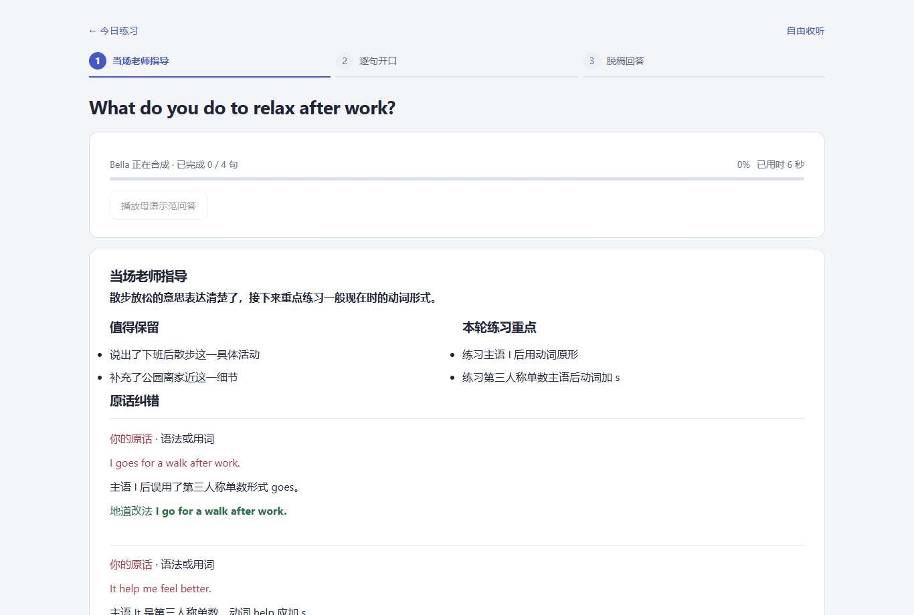
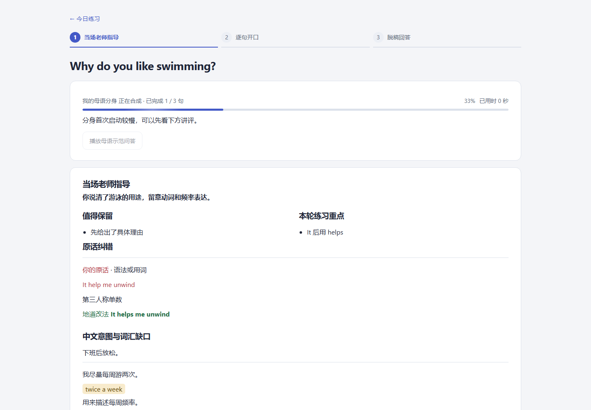
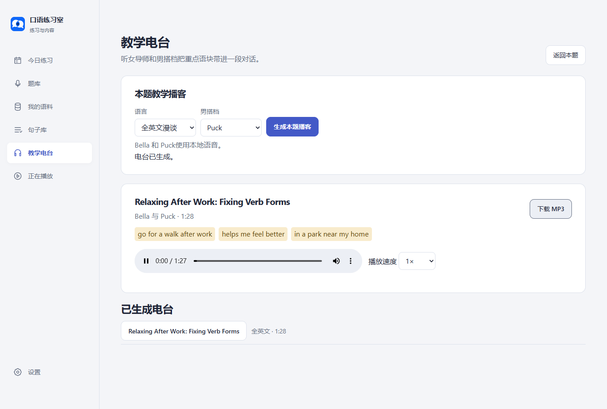
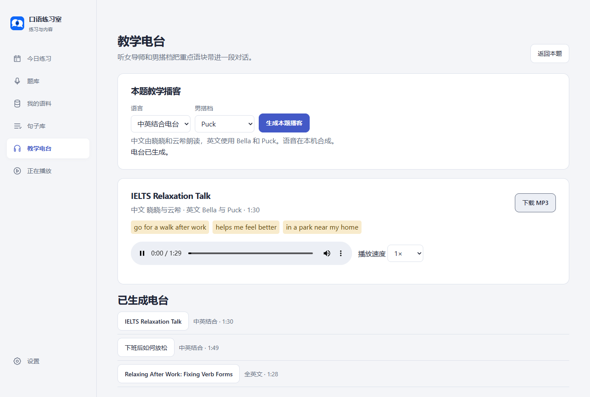
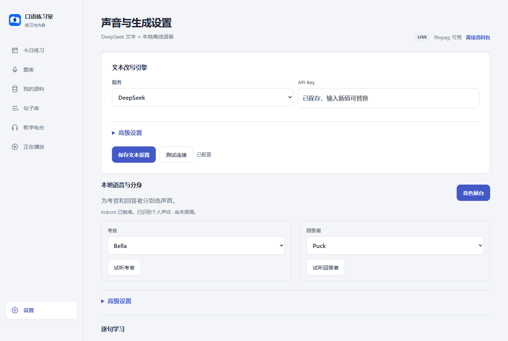

# Windows 桌面离线语音验收

2026-11-25。验收输入为合成口语样本。实机服务使用 `127.0.0.1:8766` 和独立的测试语料目录，8765 上的服务继续运行。

## 当场老师指导

提交后先保存三文本和逐句材料，再启动本地语音。实际 DeepSeek 请求耗时 **6.19 秒**，提交后 **6.30 秒**已能读取总评和两条有原话证据的纠错。完整问答在 **27.17 秒**就绪，共合成四句。讲评快于音频完成，首次有效实测耗时仍超出 3–5 秒目标。

浏览器回归用受控音频进度复验了自动进入讲评、词汇缺口和迁移例句。音频就绪时，原讲评 DOM 保持原位，播放按钮直接解锁。API 回归验证了本地合成失败后仍能读取讲评，音频重试复用已有文本。





## 教学电台

| 场景 | 文本 | 本地语音 | 播放与下载 |
| --- | --- | --- | --- |
| 全英文 | DeepSeek 编排，5.19 秒返回 | Bella、Puck，10 段，87.99 秒 | Chrome 播放及 MP3 下载通过 |
| 中英结合 | DeepSeek 编排，修正提示后 4.70 秒返回，两个角色均有普通话台词 | 晓晓、云希、Bella、Puck，49 个单语片段，89.81 秒 | Chrome 播放及 MP3 下载通过 |

两份 MP3 均为 44.1 kHz 单声道，未检出连续 3 秒静音。播放器提供 0.8×–1.5× 倍速、重点语块和下载。
首轮双语请求返回全英文，校验拒绝。修正双语提示后实机复测通过。主观听感待 Bruce 抽查。




## 设置与浏览器

设置和音色展台从本地目录提供六个 Kokoro 音色和个人分身。桌面配置读到旧云语音选项时归一化为本地语音，历史 MP3 和对齐文件继续可读。



实机浏览器采集到 0 条控制台错误和警告，0 个外站浏览器请求。Service Worker 回归覆盖非 HTTP(S)、跨源请求和缓存写入失败，文档包含可安装应用的兼容元标签。

## 验证命令

```bash
bash scripts/check.sh --with-e2e
.venv/Scripts/python -m pytest workflows/qoder-one-question/scripts/test_one_question.py -q
.venv/Scripts/python -u tmp/plan7-walkthrough/live_check.py
.venv/Scripts/python -u tmp/plan7-walkthrough/live_check.py --bilingual-fixture
.venv/Scripts/python -u tmp/plan7-walkthrough/live_check.py --bilingual-only
ffprobe -v error -show_entries format=duration:stream=codec_name,sample_rate,channels <sample.mp3>
```

完整门禁包含 Ruff、295 项单元/API 通过、1 项跳过、应用导入和启动冒烟、76 项 Playwright 通过。单题工作流 9 项通过。Windows 沙箱会阻塞 Python 本机 socket，质量门禁在可启用本机 socket 的环境运行。浏览器使用存放在工作区临时目录的 Playwright Chromium。实机脚本、MP3 和结构化结果保存在当前工作区的 `tmp/plan7-walkthrough/`。
